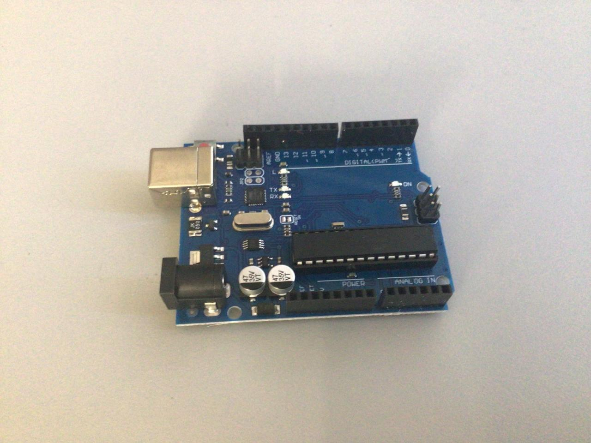
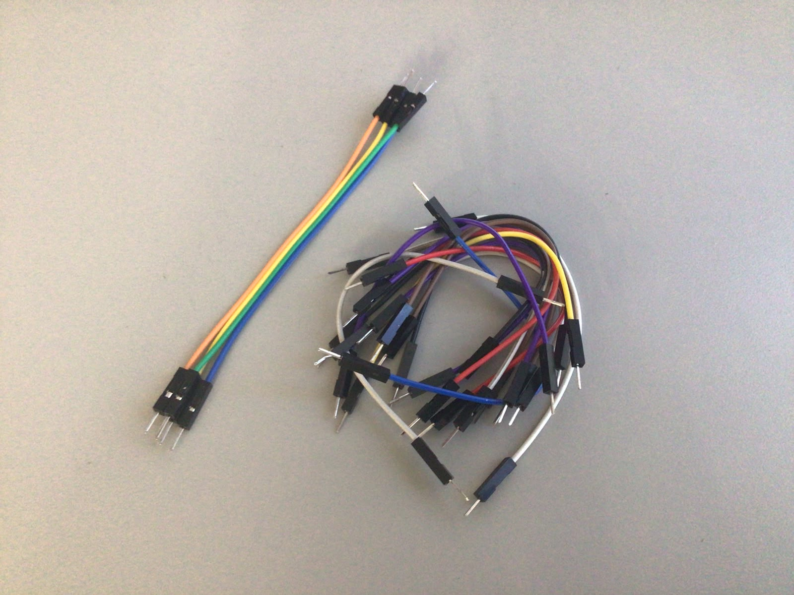
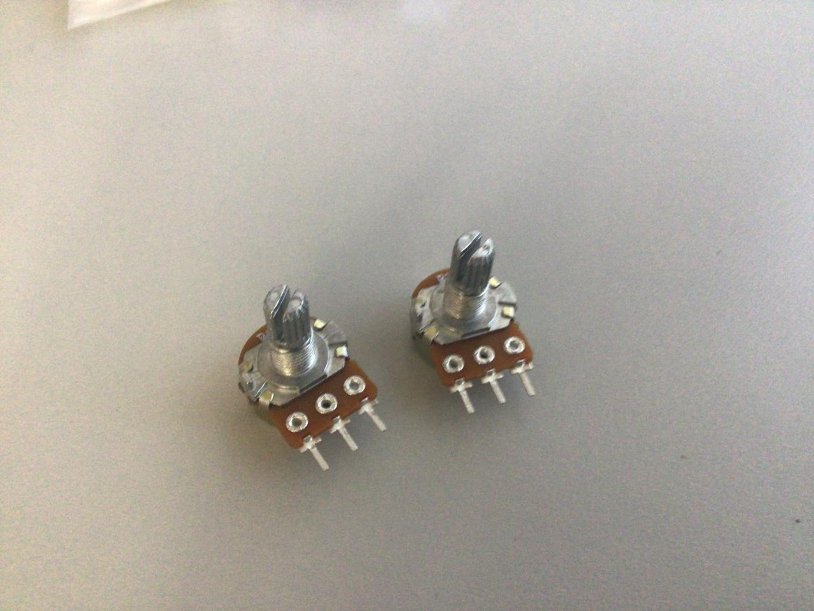
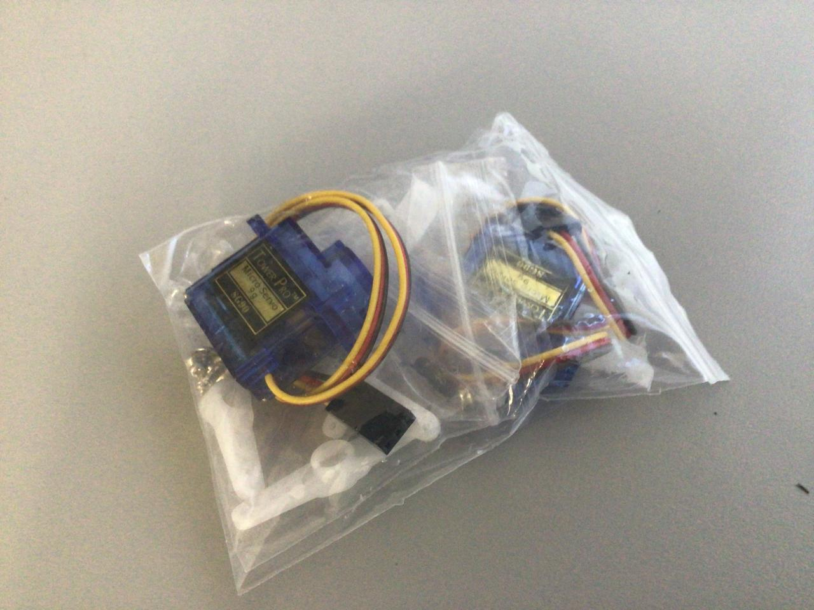
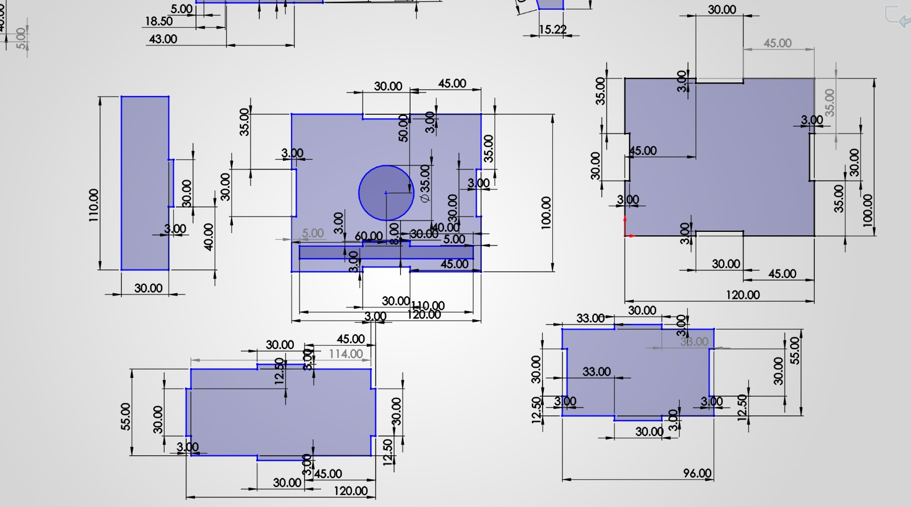
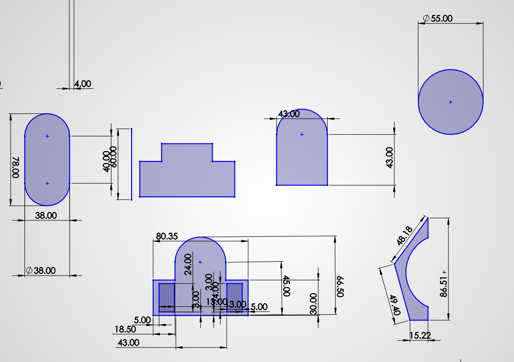
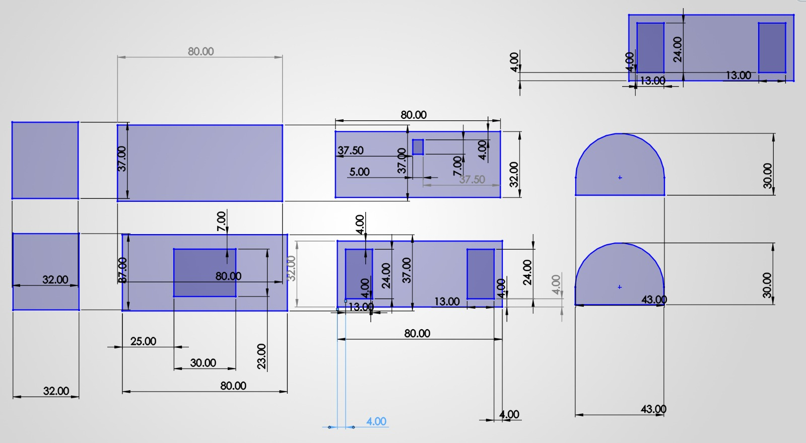
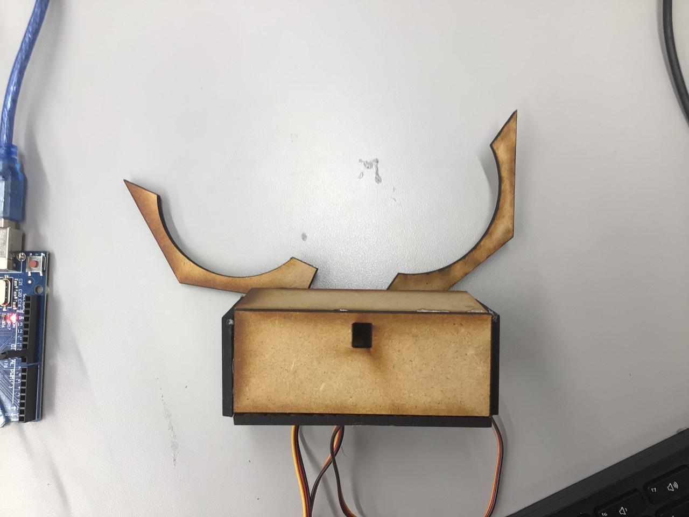
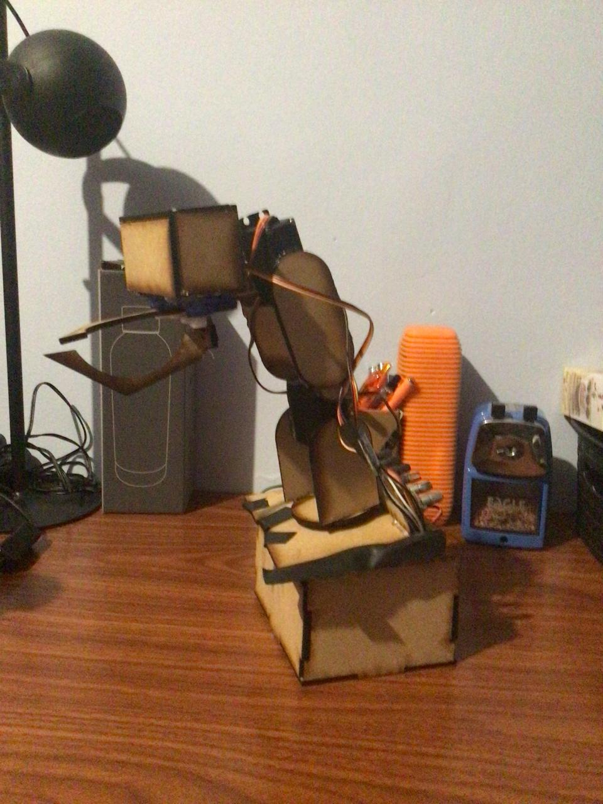

# Semana 4: Brazo Robótico

## Objetivo 

Aquí voy a detallar todo lo que hice para crear mi brazo robóticoy lo que aprendí en el rpoceso poruqe ciertamente fue un proyecto bastante demandante. Pero entre otras cosas ví diseño en SolidWorks, usar la cortadora láser, circuitos con arduino, programación de una arduino, hacer un circuito con mútiples elementos. 

## Materiales

A continucación pondré todos los materiales que usé para contruir mi garra

1.- Una tarjeta arduino UNO

2.- Jumpers (tanto hembras como machos).

3.- 6 potenciometros.

4.- 3 servomotores mg95.

5.- 3 servomotores sg90.

## Diseños en Solid Works

1.- **Instalar**: T

2.- **Interfaz**: T

3.- **Interfaz Código**: T

